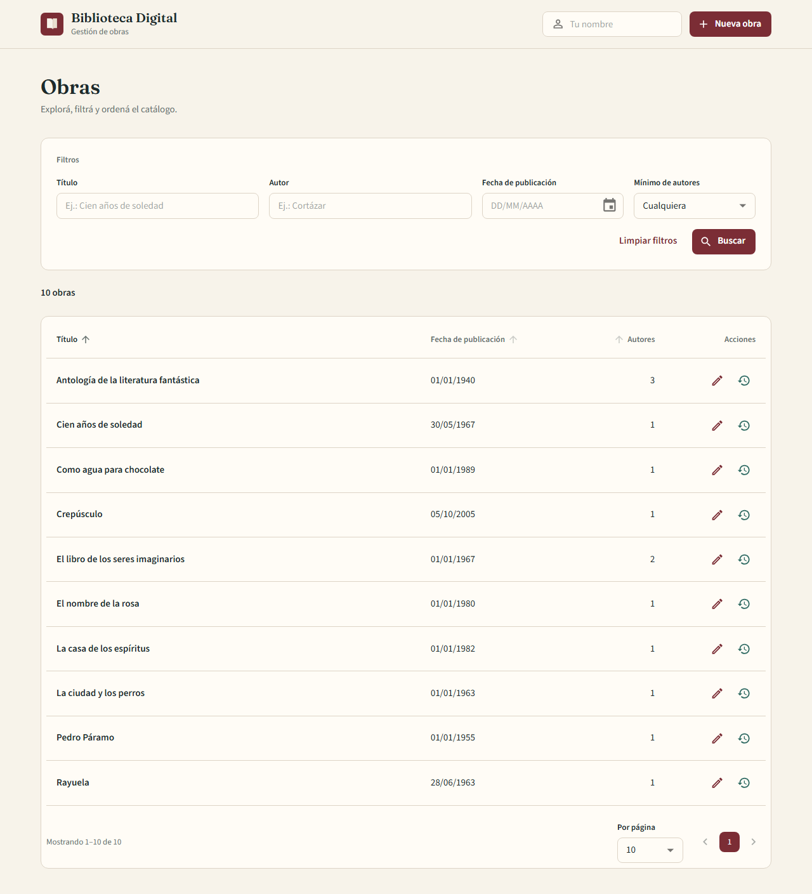
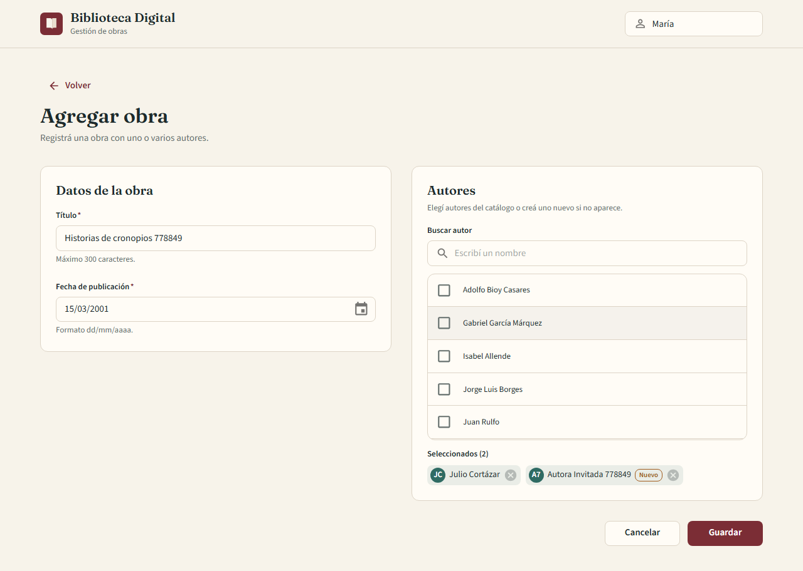
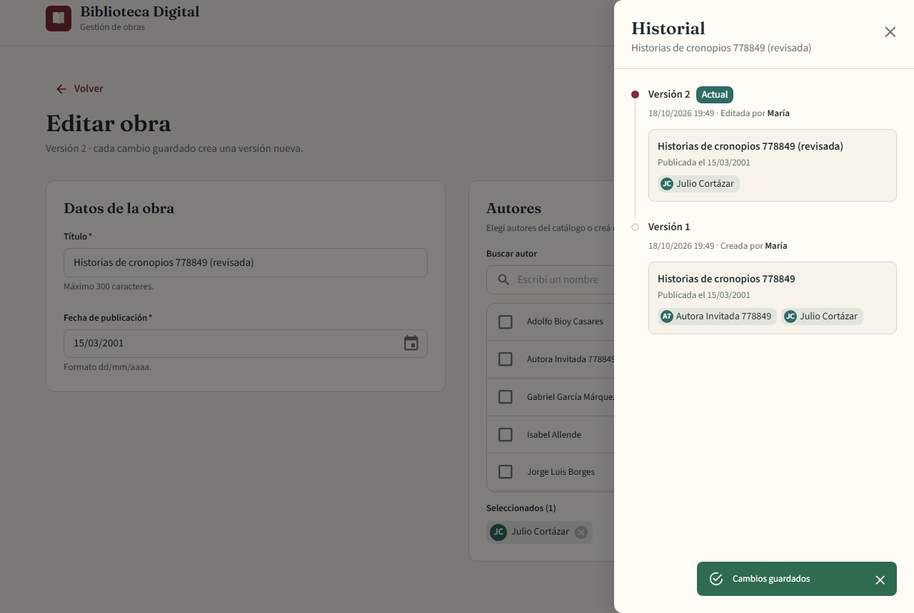
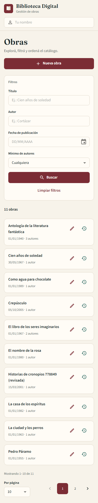
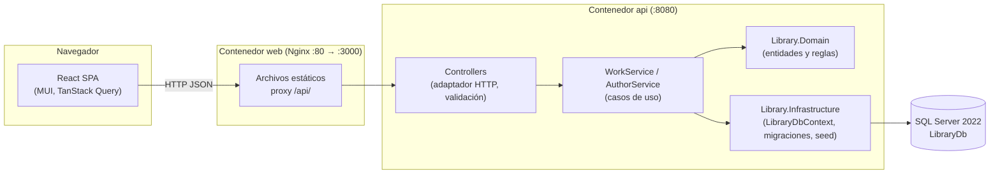
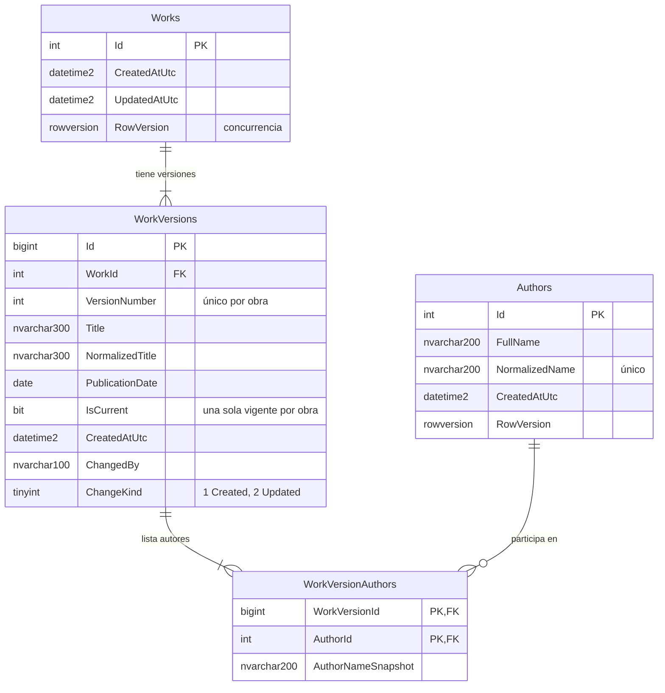

# Biblioteca Digital

Aplicación web para gestionar **obras literarias**: registrar obras con autores existentes o nuevos, editarlas sin perder la historia, y explorar el catálogo con filtros acumulativos, orden y paginación.

Challenge técnico Fullstack **.NET 10 + React 19 + SQL Server 2022**.



| Formulario (autor existente + nuevo) | Historial de versiones | Mobile |
|---|---|---|
|  |  |  |

---

## Índice

- [Inicio rápido](#inicio-rápido)
- [Stack](#stack)
- [Arquitectura](#arquitectura)
- [Modelo de datos](#modelo-de-datos)
- [Reglas de negocio](#reglas-de-negocio)
- [API](#api)
- [Desarrollo local sin Docker](#desarrollo-local-sin-docker)
- [Variables de entorno](#variables-de-entorno)
- [Migraciones y seed](#migraciones-y-seed)
- [Pruebas y cobertura](#pruebas-y-cobertura)
- [Decisiones y tradeoffs](#decisiones-y-tradeoffs)
- [Limitaciones](#limitaciones)
- [Próximos pasos](#próximos-pasos)
- [Documentación adicional](#documentación-adicional)

---

## Inicio rápido

Requisito: Docker Desktop (o Docker Engine + Compose v2).

```bash
git clone https://github.com/J1u2a3n8/coding-band-library-challenge.git
cd coding-band-library-challenge
docker compose up --build
```

| Servicio | URL |
|---|---|
| Frontend | http://localhost:3000 |
| API | http://localhost:8080 |
| Swagger | http://localhost:8080/swagger |
| Health | http://localhost:8080/health |
| SQL Server | `localhost,1433` (usuario `sa`) |

Al iniciar, la API aplica las migraciones y carga datos de ejemplo (12 autores, 10 obras). Los datos quedan en el volumen `sqlserver-data`; `docker compose down -v` los borra.

La contraseña de SQL Server se toma de `.env` (copiar `.env.example`). Si no existe `.env`, Compose usa el mismo valor de ejemplo **solo para la demo local**, así funciona desde un clon limpio.

---

## Stack

| Capa | Tecnologías |
|---|---|
| Backend | .NET 10, ASP.NET Core **Controllers**, EF Core 10 (SQL Server), FluentValidation, Swashbuckle (Swagger + anotaciones + XML) |
| Base de datos | SQL Server 2022 Developer en Docker, migraciones EF Core |
| Frontend | React 19, TypeScript, Vite, MUI 7 (tema propio), TanStack Query 5, React Hook Form + Zod, MUI X Date Pickers + dayjs, React Router |
| Pruebas backend | xUnit, `WebApplicationFactory`, Testcontainers (SQL Server real), Respawn, coverlet |
| Pruebas frontend | Vitest, React Testing Library, user-event, MSW, `@vitest/coverage-v8`; Playwright para el smoke test |
| Infraestructura | Docker Compose, Nginx (SPA + proxy `/api`), GitHub Actions |

Todas las dependencias tienen licencia libre (MIT / Apache-2.0). No se usa AutoMapper, MediatR ni FluentAssertions.

> **Versión de MUI:** se usa MUI 7.3 y no 9.x porque la versión estable de `@mui/x-date-pickers` (8.29) solo es compatible con MUI ≤ 7. Es la estable más cercana compatible.

---

## Arquitectura

Tres proyectos de producción y dos de pruebas. Sin capa Application vacía ni repositorio genérico.



| Proyecto | Responsabilidad | Depende de |
|---|---|---|
| `Library.Domain` | Entidades (`Work`, `WorkVersion`, `Author`, `WorkVersionAuthor`), invariantes, `TextNormalizer` | nada |
| `Library.Infrastructure` | `LibraryDbContext`, configuraciones EF, migraciones, seed | Domain |
| `Library.Api` | Controllers, DTOs, validadores, `WorkService`, `AuthorService`, manejo de errores, Swagger | Infrastructure, Domain |

Los controllers solo reciben el request, validan, llaman al servicio y devuelven la respuesta. La lógica vive en los servicios y en el dominio. Más detalle en [docs/architecture.md](docs/architecture.md).

---

## Modelo de datos

`Works` es la identidad de la obra; el contenido vive en `WorkVersions` (una fila por versión, inmutable). Cada versión guarda sus autores con un snapshot del nombre.



Índices principales: `UX_Authors_NormalizedName` (único), `UX_WorkVersions_Current` (único filtrado `IsCurrent = 1`), `UX_WorkVersions_WorkId_VersionNumber`, `IX_WorkVersions_Current_Title` y `IX_WorkVersions_Current_PublicationDate` (filtrados), `IX_WorkVersionAuthors_AuthorId_WorkVersionId`. Justificación en [docs/database.md](docs/database.md).

---

## Reglas de negocio

### Autores nuevos y existentes
El formulario de la obra permite marcar autores del catálogo o crear uno nuevo en el momento. En la API, cada autor del request trae **solo uno** de estos campos:

```json
{ "id": 12 }                    // autor existente
{ "name": "Julio Cortázar" }    // se reutiliza si existe, si no se crea
```

Los autores nuevos se crean **dentro de la misma transacción** que la obra: si algo falla, no queda ni la obra ni el autor.

### Deduplicación
- El nombre se normaliza: sin espacios extra, sin tildes, en minúsculas (`"  JULIO   Cortázar "` → `"julio cortazar"`). Se guarda el original en `FullName`.
- `NormalizedName` tiene índice único. Antes de crear se busca; si existe, se reutiliza.
- Autores repetidos en el mismo request (por id o por nombre normalizado, o uno por id y otro por nombre) se unifican.
- Si dos requests crean el mismo autor a la vez, el índice único rechaza el segundo insert (`SqlException` 2601/2627); se captura y se usa el autor existente.
- **Limitación:** dos personas distintas con el mismo nombre (homónimos) quedarían unificadas. Ver [ADR-004](docs/decisions/ADR-004-deduplicacion-autores.md).

### Versionado (integridad histórica)
- Crear una obra genera la versión 1 (`Created`).
- Editar compara título normalizado, fecha y conjunto de autores. **Si no hay cambios, no se crea versión.**
- Si hay cambios, en una transacción: la versión vigente pasa a `IsCurrent = 0`, se guarda (esto libera el índice único filtrado) y se inserta la versión N+1 con sus autores y el snapshot de sus nombres.
- Las versiones anteriores nunca se modifican ni se borran. `GET /api/works/{id}/history` las devuelve todas.
- `ChangedBy` guarda quién generó cada versión, tomado del header `X-Actor` (en la UI: campo "Tu nombre" del encabezado). Es auditoría de demo, **no autenticación**. Si falta, se guarda `anonymous`.

### Concurrencia
`Works.RowVersion` es un `rowversion` de SQL Server. El GET devuelve `rowVersion` en Base64; el PUT lo reenvía. Si otra persona guardó antes, el `UPDATE` no encuentra la fila con ese valor → `409 Conflict`. La UI muestra "La obra fue modificada por otro usuario" con opciones **Recargar** y **Cancelar**.

### Filtros, orden y paginación
- Filtros `title`, `authorName`, `publicationDate` (exacta) y `minimumAuthorCount`: todos opcionales, combinados con **AND**. Los vacíos se ignoran.
- Texto por "contiene", sin distinguir tildes ni mayúsculas.
- Orden por `title` (default), `publicationDate` o `authorCount`, ascendente o descendente, siempre con desempate por `WorkId` → paginación estable.
- Todo se resuelve en SQL Server con EF Core (`IQueryable` → una consulta de conteo y una de página). Nunca se trae la tabla completa.
- En la UI el estado vive en la URL (`?title=...&minimumAuthorCount=2&sortBy=authorCount&pageNumber=2`): se puede refrescar, compartir y volver atrás. Los textos se aplican con debounce de 300 ms; "Buscar" aplica en el momento.

---

## API

Base: `/api`. Errores en formato ProblemDetails. Documentación interactiva en **http://localhost:8080/swagger**.

| Método | Ruta | Descripción | Respuestas |
|---|---|---|---|
| GET | `/api/works` | Listar con filtros, orden y página | 200, 400 |
| GET | `/api/works/{id}` | Versión vigente con autores y `rowVersion` | 200, 404 |
| POST | `/api/works` | Crear obra (autores existentes y/o nuevos) | 201, 400 |
| PUT | `/api/works/{id}` | Editar (crea versión N+1 si hay cambios) | 200, 400, 404, 409 |
| GET | `/api/works/{id}/history` | Historial, versión más nueva primero | 200, 404 |
| GET | `/api/authors?search=&pageSize=` | Buscar autores (1..20) | 200, 400 |
| GET | `/health` | Estado de la API y la base | 200, 503 |

Ejemplos rápidos (más en [docs/api-examples.md](docs/api-examples.md)):

```bash
# Crear una obra con un autor existente (id 2) y uno nuevo
curl -X POST http://localhost:8080/api/works \
  -H "Content-Type: application/json" \
  -H "X-Actor: Maria" \
  -d '{"title":"Historias de cronopios y de famas","publicationDate":"1962-01-01","authors":[{"id":2},{"name":"Autora Invitada"}]}'

# Filtros combinados: título contiene "libro", autor Borges, fecha exacta y al menos 2 autores
curl "http://localhost:8080/api/works?title=libro&authorName=borges&publicationDate=1967-01-01&minimumAuthorCount=2"
```

Respuesta del listado:

```json
{
  "items": [
    { "id": 10, "title": "El libro de los seres imaginarios", "publicationDate": "1967-01-01", "authorCount": 2 }
  ],
  "pageNumber": 1,
  "pageSize": 10,
  "totalItems": 1,
  "totalPages": 1
}
```

Error de validación:

```json
{
  "type": "https://tools.ietf.org/html/rfc9110#section-15.5.1",
  "title": "Validation failed",
  "status": 400,
  "detail": "One or more validation errors occurred.",
  "errors": { "title": ["El título es obligatorio."] }
}
```

> `X-Actor` con tildes: los headers HTTP solo aceptan ASCII, por eso la UI lo envía URL-encoded (`Mar%C3%ADa`) y la API lo decodifica.

---

## Desarrollo local sin Docker

Requisitos: .NET SDK 10, Node 24 y un SQL Server accesible (el de Compose sirve: `docker compose up -d sqlserver`).

```bash
# API en http://localhost:8080 (perfil "http"; en Development aplica migraciones y seed)
export ConnectionStrings__DefaultConnection="Server=localhost,1433;Database=LibraryDb;User Id=sa;Password=<tu-password>;Encrypt=True;TrustServerCertificate=True;"
dotnet run --project src/Library.Api

# Frontend en http://localhost:5173 (Vite redirige /api a localhost:8080)
cd web
npm ci
npm run dev
```

En PowerShell: `$env:ConnectionStrings__DefaultConnection = "Server=localhost,1433;..."`.

---

## Variables de entorno

| Variable | Dónde | Descripción |
|---|---|---|
| `MSSQL_SA_PASSWORD` | `.env` | Contraseña de SA del contenedor SQL Server |
| `API_PORT` / `WEB_PORT` | `.env` | Puertos publicados (8080 / 3000) |
| `ConnectionStrings__DefaultConnection` | API | Cadena de conexión (Compose la arma con `MSSQL_SA_PASSWORD`) |
| `ApplyMigrations` | API | `true` aplica migraciones al iniciar (demo Docker) |
| `SeedData__Enabled` | API | `true` carga datos de ejemplo si la base está vacía |
| `Swagger__Enabled` | API | `true` publica Swagger fuera de Development |
| `Cors__AllowedOrigins__0..n` | API | Orígenes permitidos (por defecto 5173, 3000, 4173) |

`appsettings*.json` no tienen secretos. `.env` está en `.gitignore`. El usuario `sa` es solo para el challenge; en producción se usa un usuario con permisos mínimos y un gestor de secretos.

---

## Migraciones y seed

```bash
# Crear una migración nueva (herramienta local en dotnet-tools.json)
dotnet tool restore
dotnet ef migrations add <Nombre> -p src/Library.Infrastructure -s src/Library.Infrastructure -o Persistence/Migrations

# Aplicar manualmente (en producción sería un paso separado del despliegue)
dotnet ef database update -p src/Library.Infrastructure -s src/Library.Infrastructure
```

- No se usa `EnsureCreated`: el esquema sale solo de la migración `InitialCreate`.
- El seed (`DataSeeder`) es idempotente: si ya hay autores u obras, no hace nada. Incluye una obra con 3 autores (*Antología de la literatura fantástica*: Borges, Bioy Casares, Ocampo) y una con 2 (*El libro de los seres imaginarios*).

---

## Pruebas y cobertura

| Suite | Herramientas | Pruebas | Cobertura |
|---|---|---|---|
| Backend unitarias | xUnit | 90 | combinada con integración: **98,0 % líneas** |
| Backend integración | `WebApplicationFactory` + Testcontainers (SQL Server 2022 real) + Respawn | 54 | (integración sola: 92,5 % líneas) |
| Frontend | Vitest + Testing Library + MSW | 89 | **98,1 % líneas · 96,7 % ramas · 96,7 % funciones · 98,0 % sentencias** |
| Smoke E2E | Playwright contra Docker (incluye 409 con dos pestañas) | 3 | no cuenta para cobertura |

```bash
# Backend: unit + integración, cobertura combinada con umbral de 80 % de líneas (requiere Docker)
dotnet test -m:1 -p:CollectCoverage=true -p:Threshold=80 -p:ThresholdType=line
# Reporte en coverage/backend/coverage.cobertura.xml

# Frontend: lint, formato, pruebas con umbrales de 80 % (líneas, funciones, ramas, sentencias) y build
cd web
npm run lint && npm run format:check && npm run test:coverage && npm run build

# Smoke test de punta a punta (con docker compose up corriendo)
npx playwright install chromium
npm run test:e2e            # SCREENSHOTS=1 regenera docs/screenshots
```

> En Git Bash para Windows usar `-p:` en lugar de `/p:` (Git Bash convierte `/p:` en una ruta).

Qué cubren:

- **Dominio:** normalización, invariantes de `Work`/`WorkVersion`, detección de "sin cambios".
- **Validación:** reglas de creación/edición, `rowVersion` Base64, rangos de paginación.
- **Integración HTTP + SQL real:** alta con autor existente/nuevo/mixto, deduplicación, rollback si falla, versión N+1, no-op, historial inmutable con snapshot, los 4 filtros y su combinación AND, los 3 órdenes en ambas direcciones, paginación estable, 400/404/409, dos ediciones simultáneas (una 200, otra 409), carrera de creación de autor, índice único, seed idempotente, health y Swagger.
- **UI:** URL ↔ filtros, debounce, limpiar, chips, orden con `aria-sort`, paginación, tabla y cards mobile, estados loading/empty/error, formulario y validación, AuthorPicker (buscar, seleccionar, crear, "Ya existe", duplicados, máximo 20), 409 con Recargar/Cancelar, historial, `apiClient` y ProblemDetails.

La CI (GitHub Actions) corre todo lo anterior en cada push a `main`, más `docker compose build`, el stack completo y el smoke test de Playwright.

---

## Decisiones y tradeoffs

| Decisión | Por qué | Costo aceptado |
|---|---|---|
| SQL Server 2022 en Docker ([ADR-001](docs/decisions/ADR-001-sql-server-docker.md)) | Motor del puesto; `rowversion` e índices filtrados; reproducible | Imagen pesada (~1,5 GB) |
| Versiones inmutables con snapshot ([ADR-002](docs/decisions/ADR-002-versionado-snapshots.md)) | Historia consultable y fácil de probar | Más filas; la cantidad de autores se calcula |
| EF Core, sin stored procedures ([ADR-003](docs/decisions/ADR-003-ef-core-vs-stored-procedures.md)) | Filtros opcionales componibles, SQL parametrizado, testeable | Menos control fino del plan de ejecución |
| Nombre normalizado único ([ADR-004](docs/decisions/ADR-004-deduplicacion-autores.md)) | Evita duplicados simple y con garantía de la base | Homónimos se unifican |
| Sin autenticación ([ADR-005](docs/decisions/ADR-005-sin-autenticacion.md)) | Fuera del alcance; `X-Actor` solo para el historial | Cualquiera puede editar |
| Diseño editorial propio ([ADR-006](docs/decisions/ADR-006-diseno-ui.md)) | UI de catálogo, no dashboard genérico | Más trabajo de tema |
| Controllers, no Minimal APIs ([ADR-007](docs/decisions/ADR-007-controllers-vs-minimal-apis.md)) | Legibilidad y Swagger descriptivo | Algo más de código |
| Mapeo manual, sin AutoMapper ([ADR-008](docs/decisions/ADR-008-mapeo-manual-sin-automapper.md)) | Pocos DTOs; proyecciones LINQ; errores en compilación | Algunas líneas repetidas |
| Lógica de casos de uso en `Api/Services` | Evita una capa Application vacía | Si crece, conviene separar |

**Decisiones consultadas con el usuario** (no estaban definidas en el enunciado):

1. La UI envía `X-Actor` desde un campo "Tu nombre" del encabezado (guardado en el navegador). Aclarado en la UI: no es un login.
2. Seed: se reemplazó *Ficciones* por *Antología de la literatura fantástica* (1940) para tener 12 autores, 10 obras y una obra real con 3 autores.
3. Contraseña de SA: Compose usa `.env` y, si no existe, el valor de ejemplo como fallback de demo local.

---

## Limitaciones

- **Homónimos:** dos autores distintos con el mismo nombre se unifican.
- **Búsqueda por `LIKE '%texto%'`:** no usa el índice como búsqueda por prefijo; con muchos datos conviene full-text search. Sin búsqueda difusa ("borjes" no encuentra "Borges").
- **Fecha exacta:** el filtro de fecha es por día exacto, no por rango.
- **Sin borrado** de obras ni edición/borrado de autores (fuera del alcance).
- **Sin autenticación ni autorización:** `X-Actor` es un dato libre que cualquiera puede enviar.
- `AuthorCount` se calcula en cada consulta (`COUNT`); con millones de filas convendría denormalizarlo.

## Próximos pasos

- **Autenticación/autorización:** OIDC (Cognito / Entra ID) con JWT; `ChangedBy` desde el claim del usuario; roles lectura / edición / auditoría.
- **AWS:** API en ECS Fargate o App Runner, SQL Server en RDS, frontend en S3 + CloudFront, secretos en Secrets Manager, logs y métricas en CloudWatch, deploy desde GitHub Actions con OIDC. Migraciones como paso separado del pipeline.
- **Observabilidad:** logs estructurados con correlation id, OpenTelemetry (trazas y métricas), alertas sobre 5xx y latencia.
- **Datos:** alias/merge manual de autores, full-text search, rango de fechas, denormalizar `AuthorCount` si escala, borrado lógico.
- **Seguridad:** rate limiting, headers de seguridad en Nginx, usuario de base con permisos mínimos.

---

## Documentación adicional

- [docs/architecture.md](docs/architecture.md): componentes y flujos de creación, actualización y consulta.
- [docs/database.md](docs/database.md): tablas, índices, consulta de filtros, versionado y escala.
- [docs/api-examples.md](docs/api-examples.md): ejemplos `curl` de todos los endpoints.
- [docs/defense.md](docs/defense.md): guía para la defensa técnica.
- [docs/decisions/](docs/decisions/): ADRs.

---

## Autor

**Juan Luis Canedo Villarroel** — [@J1u2a3n8](https://github.com/J1u2a3n8)
