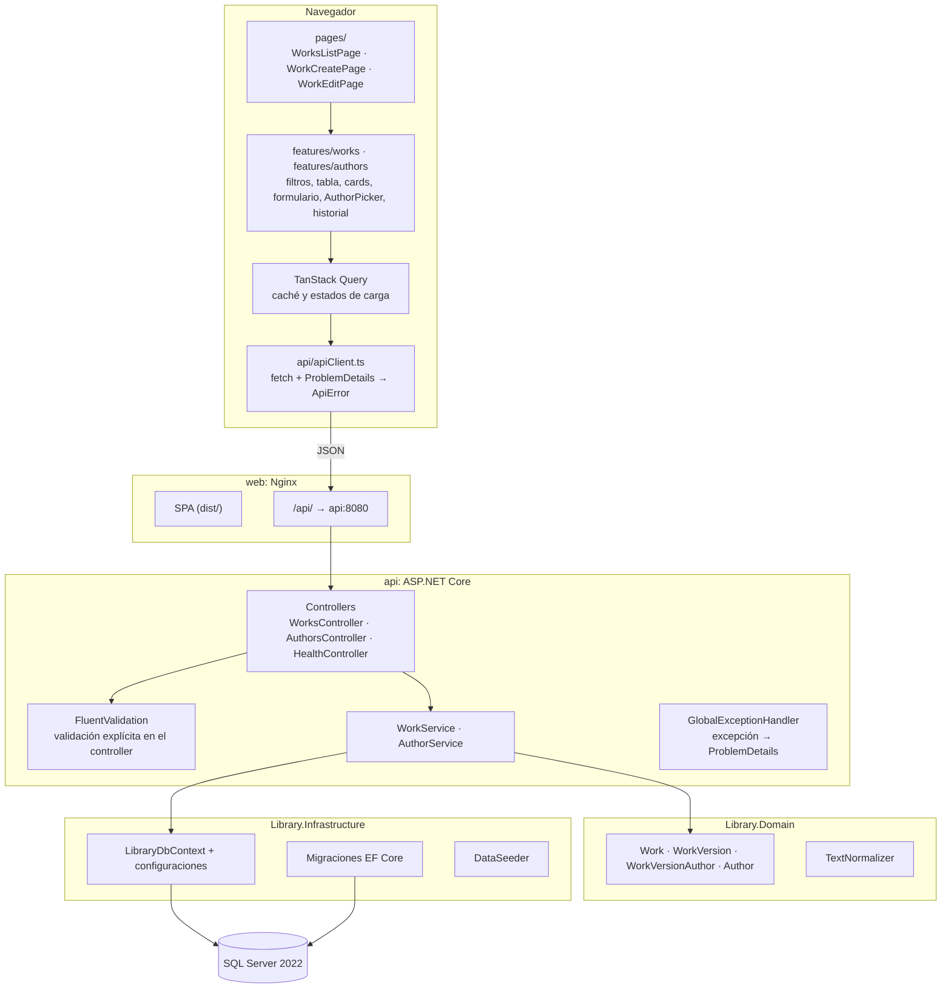
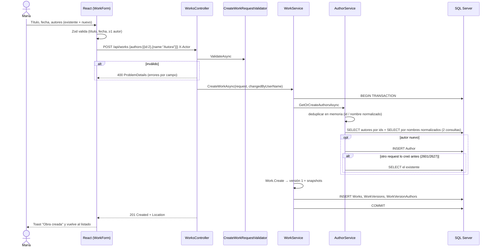
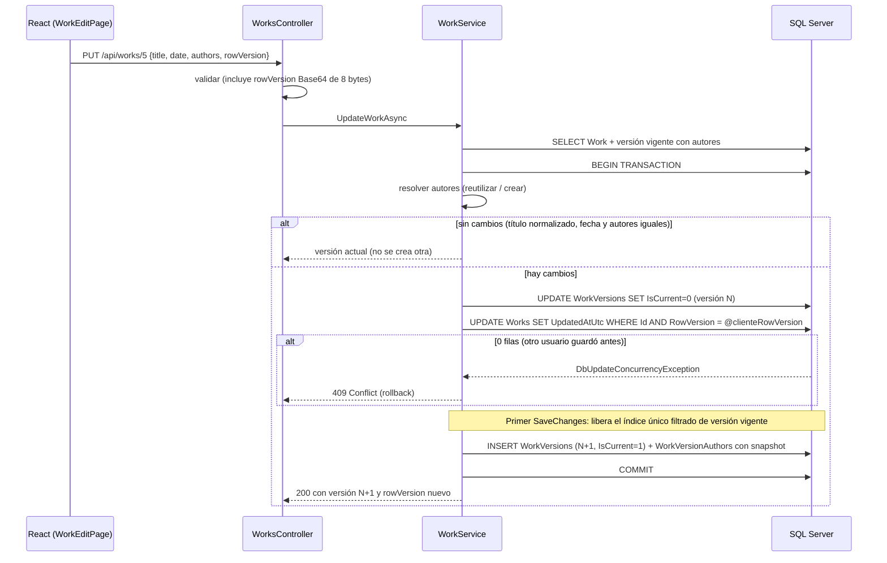
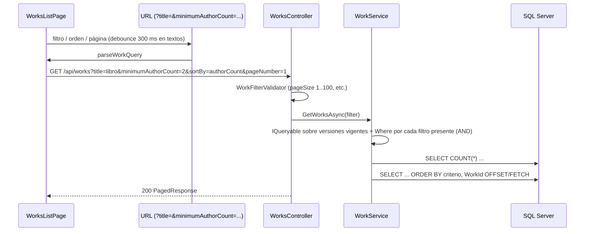

# Arquitectura

## Componentes

### Reglas de dependencia

- `Library.Domain` no conoce EF Core ni ASP.NET. Las entidades protegen sus invariantes (al menos un autor, máximo 20, sin autores repetidos, título 1..300, solo `IsCurrent` puede cambiar en una versión).
- `Library.Infrastructure` traduce el dominio a tablas (Fluent API) y tiene migraciones y seed.
- `Library.Api` contiene el adaptador HTTP (controllers), los contratos (DTOs) y los casos de uso (servicios).

### Decisiones de simplicidad

| Lo que no se hizo | Por qué |
|---|---|
| Capa `Application` separada | Tendría solo dos servicios; se mantienen en `Api/Services` y usan `LibraryDbContext` directo |
| Repositorio genérico / Unit of Work | `DbContext` ya es ambas cosas; envolverlo esconde `Include`, proyecciones y transacciones |
| MediatR / CQRS | Agrega indirección sin beneficio para 6 endpoints |
| AutoMapper | Pocos DTOs; mapeo manual y proyecciones LINQ ([ADR-008](decisions/ADR-008-mapeo-manual-sin-automapper.md)) |
| Minimal APIs | Controllers por legibilidad y Swagger descriptivo ([ADR-007](decisions/ADR-007-controllers-vs-minimal-apis.md)) |
| Interfaces para cada servicio | Una sola implementación; las pruebas de integración usan la API real |

`TimeProvider` se inyecta para no usar `DateTime.Now` y poder controlar el tiempo.

---

## Flujo de creación

Si cualquier paso falla (por ejemplo, un `id` de autor que no existe), la transacción se revierte: no queda ni la obra ni los autores nuevos.

---

## Flujo de actualización

Por qué dos `SaveChanges`: el índice `UX_WorkVersions_Current` admite una sola fila `IsCurrent = 1` por obra. Si se inserta la versión nueva en el mismo comando que apaga la anterior, SQL Server puede evaluar el índice con dos vigentes. Guardar primero el apagado y después el alta, dentro de la misma transacción, mantiene la regla sin estados intermedios visibles.

---

## Flujo de consulta

- Solo se leen versiones vigentes (`IsCurrent = 1`), con `AsNoTracking` y proyección directa al DTO.
- La cantidad de autores es una subconsulta `COUNT` en el mismo `SELECT`: no hay N+1.
- El frontend mantiene la página anterior visible mientras llega la nueva (`keepPreviousData`).
