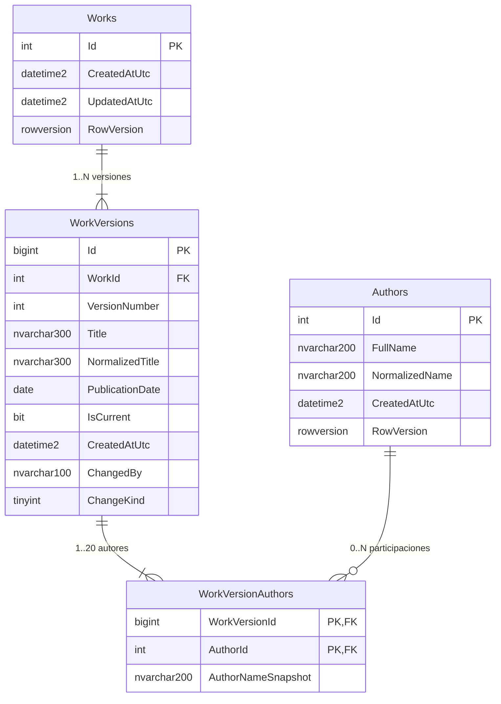

# Base de datos

SQL Server 2022 Developer, base `LibraryDb`. El esquema se crea solo con migraciones EF Core (`InitialCreate`); no se usa `EnsureCreated`.

## ERD



## Tablas

### Authors
| Columna | Tipo | Regla |
|---|---|---|
| `Id` | `int identity` | PK |
| `FullName` | `nvarchar(200)` | nombre como se escribió (sin espacios extra) |
| `NormalizedName` | `nvarchar(200)` | sin tildes, minúsculas, espacios simples; **único** |
| `CreatedAtUtc` | `datetime2` | UTC |
| `RowVersion` | `rowversion` | concurrencia |

Un autor puede existir sin obras. Nunca se borra.

### Works
| Columna | Tipo | Regla |
|---|---|---|
| `Id` | `int identity` | PK, identidad estable de la obra |
| `CreatedAtUtc` / `UpdatedAtUtc` | `datetime2` | UTC |
| `RowVersion` | `rowversion` | cambia en cada edición; base del 409 |

### WorkVersions
| Columna | Tipo | Regla |
|---|---|---|
| `Id` | `bigint identity` | PK |
| `WorkId` | `int` | FK → `Works` (`RESTRICT`) |
| `VersionNumber` | `int` | 1, 2, 3… por obra |
| `Title` / `NormalizedTitle` | `nvarchar(300)` | original y normalizado |
| `PublicationDate` | `date` | `DateOnly` en C#; sin hora ni zona horaria |
| `IsCurrent` | `bit` | una sola vigente por obra |
| `CreatedAtUtc` | `datetime2` | UTC |
| `ChangedBy` | `nvarchar(100)` | quién generó la versión (`X-Actor` o `anonymous`) |
| `ChangeKind` | `tinyint` | `1 = Created`, `2 = Updated` |

### WorkVersionAuthors
| Columna | Tipo | Regla |
|---|---|---|
| `WorkVersionId` | `bigint` | PK compuesta, FK → `WorkVersions` (`CASCADE`) |
| `AuthorId` | `int` | PK compuesta, FK → `Authors` (`RESTRICT`) |
| `AuthorNameSnapshot` | `nvarchar(200)` | nombre del autor al crear la versión |

## Índices y por qué

| Índice | Columnas | Motivo |
|---|---|---|
| `UX_Authors_NormalizedName` | `Authors(NormalizedName)` único | Deduplicación garantizada por la base, también con requests concurrentes. Además acelera la búsqueda exacta por nombre al crear |
| `UX_WorkVersions_WorkId_VersionNumber` | `(WorkId, VersionNumber)` único | No puede haber dos "versión 2" de la misma obra. Sirve para leer el historial ordenado |
| `UX_WorkVersions_Current` | `(WorkId) WHERE IsCurrent = 1` único filtrado | Exactamente una versión vigente por obra. Es la regla de integridad central del versionado |
| `IX_WorkVersions_Current_Title` | `(NormalizedTitle) WHERE IsCurrent = 1` | Orden por título y búsquedas solo sobre vigentes; el índice no carga versiones históricas |
| `IX_WorkVersions_Current_PublicationDate` | `(PublicationDate) WHERE IsCurrent = 1` | Filtro por fecha exacta (seek) y orden por fecha |
| `IX_WorkVersionAuthors_AuthorId_WorkVersionId` | `(AuthorId, WorkVersionId)` | Camino inverso autor → versiones para el filtro por autor (la PK ya cubre versión → autores) |

Las FK hacia `Works` y `Authors` son `RESTRICT`: no se puede borrar una obra o un autor con historia. La FK de `WorkVersionAuthors` hacia `WorkVersions` es `CASCADE` solo por coherencia del modelo; las versiones no se borran.

## Consulta de filtros (SQL generado)

Para `GET /api/works?title=libro&authorName=borges&publicationDate=1967-01-01&minimumAuthorCount=2&sortBy=authorCount&sortDirection=desc&pageNumber=1&pageSize=10`, EF Core genera (simplificado):

```sql
SELECT v.WorkId AS Id, v.Title, v.PublicationDate,
       (SELECT COUNT(*) FROM WorkVersionAuthors a WHERE a.WorkVersionId = v.Id) AS AuthorCount
FROM WorkVersions AS v
WHERE v.IsCurrent = 1
  AND v.NormalizedTitle LIKE @title_contains ESCAPE N'\'          -- '%libro%'
  AND EXISTS (SELECT 1
              FROM WorkVersionAuthors AS wa
              JOIN Authors AS au ON au.Id = wa.AuthorId
              WHERE wa.WorkVersionId = v.Id
                AND au.NormalizedName LIKE @author_contains ESCAPE N'\')  -- '%borges%'
  AND v.PublicationDate = @publicationDate
  AND (SELECT COUNT(*) FROM WorkVersionAuthors a WHERE a.WorkVersionId = v.Id) >= @minimumAuthorCount
ORDER BY (SELECT COUNT(*) FROM WorkVersionAuthors a WHERE a.WorkVersionId = v.Id) DESC, v.WorkId
OFFSET @skip ROWS FETCH NEXT @take ROWS ONLY;
```

- Cada filtro presente agrega un `AND`; los ausentes no aparecen en el SQL.
- Todo va parametrizado (sin concatenar texto del usuario).
- El texto se normaliza en C# con la misma función que se usó al guardar, así `"Cortázar"`, `"cortazar"` y `"CORTAZAR"` coinciden sin depender de la collation.
- `ORDER BY ..., WorkId` garantiza paginación estable.
- Una segunda consulta `SELECT COUNT(*)` con los mismos filtros calcula `totalItems`.

## Estrategia de versionado

1. Crear obra: `Works` + `WorkVersions(VersionNumber = 1, IsCurrent = 1, ChangeKind = Created)` + `WorkVersionAuthors` con snapshot.
2. Editar con cambios, en una transacción:
   1. `UPDATE WorkVersions SET IsCurrent = 0` en la vigente.
   2. `UPDATE Works SET UpdatedAtUtc = ... WHERE Id = @id AND RowVersion = @rowVersionDelCliente` (0 filas → 409).
   3. `SaveChanges` (libera `UX_WorkVersions_Current`).
   4. `INSERT WorkVersions (N+1, IsCurrent = 1, Updated)` + `WorkVersionAuthors`.
   5. `SaveChanges` + `COMMIT`.
3. Editar sin cambios: no se escribe nada.

Las versiones son de solo lectura en el dominio: la única propiedad que cambia es `IsCurrent`, y solo de `true` a `false`.

## Limitaciones de la búsqueda con `LIKE`

- `LIKE '%texto%'` no puede hacer *seek* en el índice: recorre el índice filtrado de vigentes (o la tabla). Con decenas de miles de obras es rápido; con millones, no.
- No hay tolerancia a errores de tipeo ni búsqueda por palabras sueltas en otro orden.
- `NormalizedTitle` y `NormalizedName` resuelven tildes y mayúsculas, pero no plurales ni sinónimos.

## A mayor escala (≈ 1 millón de obras)

- **Full-Text Search** de SQL Server sobre `NormalizedTitle` y `Authors.NormalizedName` (o un motor externo como OpenSearch) en lugar de `LIKE`.
- **Denormalizar `AuthorCount`** en `WorkVersions` (se escribe una vez porque la versión es inmutable) e indexarlo filtrado por vigentes; elimina la subconsulta `COUNT` del filtro y del orden.
- Índices compuestos para las combinaciones más usadas (por ejemplo `(PublicationDate, NormalizedTitle) WHERE IsCurrent = 1`), guiados por Query Store.
- **Paginación por keyset** (`WHERE (Title, WorkId) > (@lastTitle, @lastId)`) para páginas profundas, en lugar de `OFFSET`.
- Conteo total aproximado o en caché si el `COUNT` exacto se vuelve caro.
- Réplica de lectura (RDS read replica) para el listado y reportes.
- Archivar versiones muy viejas en otra tabla/partición si el historial crece mucho.
